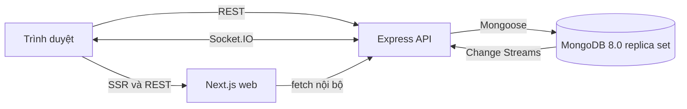

# NexTask - Kiến trúc và quyết định thiết kế

- Trạng thái: Chờ duyệt
- Ngày tạo: 2026-10-28
- Phạm vi: v1 cho team Agile, một người phát triển
- Tài liệu liên quan: [Giai đoạn 0](./phases/00-setup.md), [Ghi chú MongoDB](./mongodb-notes.md), [Lịch sử phiên](./session-log.md)

## 1. Mục tiêu và giới hạn

NexTask gộp whiteboard và Kanban trên cùng một board. Trục học tập và sản phẩm là Promote/Demote giữa hai mô hình dữ liệu, có transaction, chống trùng, optimistic concurrency và realtime.

v1 chỉ phục vụ team Agile/Scrum. Hai vai trò là Owner và Member. Sản phẩm chạy local bằng Docker Compose, chưa hướng tới triển khai production nhiều instance.

Ngoài phạm vi: thông báo, xuất dữ liệu, nhiều template, checklist, đính kèm, bình luận, Facilitator riêng, timer, CRDT, tích hợp bên ngoài, mobile, AI.

## 2. Quyết định nền tảng

| Thành phần | Phiên bản mục tiêu | Lý do |
| --- | --- | --- |
| Node.js | 26 | Khớp môi trường local; image `node:26-bookworm-slim` có sẵn; Mongoose yêu cầu Node >= 20.19 |
| TypeScript | 6.0.3 | `typescript-eslint` 8.72.1 công bố hỗ trợ TypeScript < 6.1.0; TypeScript 7 chưa tương thích toolchain lint |
| Backend | Express 5.3.0 | Ít lớp trừu tượng, async error handling có sẵn, phù hợp học sâu MongoDB |
| ODM | Mongoose 9.11.4 | Người dùng đã chọn; các hành vi ẩn được liệt kê trong ghi chú MongoDB |
| Database | MongoDB 8.0 | Replica set đơn nút hỗ trợ transaction và Change Streams |
| Frontend | Next.js 16.4.3, React 19.3.1 | App Router, TypeScript, Tailwind 4.3.3 |
| Canvas | tldraw | Không tự viết zoom, pan, kéo thả |
| Validation | zod 4.6.7 | Dùng chung schema request/response ở API và web |
| Realtime | Socket.IO 4.8.4 | Room theo board; server đẩy sự kiện từ Change Streams |
| Logging | pino 10.4.0, pino-http 11.0.0 | Log JSON có request id |
| Test | Vitest 5.0.5, Playwright 1.64.1 | Test logic, integration với MongoDB thật, một luồng E2E |
| Sắp xếp | fractional-indexing 4.0.0 | Kéo thả không phải cập nhật hàng loạt |
| Auth | argon2 0.45.1, JWT | Hash argon2id; JWT trong cookie HttpOnly |

Phiên bản trên là mục tiêu tại ngày lập tài liệu. `package-lock.json` là nguồn xác nhận phiên bản thực tế sau khi cài. Mọi thay đổi phiên bản lớn phải cập nhật tài liệu này.

### Vì sao Express thay vì NestJS

Dự án có một người làm và mục tiêu chính là hiểu MongoDB. Express giữ luồng HTTP, middleware, transaction và session ở dạng tường minh. Cấu trúc thư mục vẫn tách controller, service, repository để không biến route thành nơi chứa toàn bộ logic.

### Vì sao dùng Mongoose nhưng vẫn phải hiểu driver

Mongoose giúp schema, cast và lifecycle hook, nhưng không thay thế kiến thức MongoDB. Các điểm quan trọng:

- `autoIndex` mặc định bật; dự án đặt `autoIndex: false` và quản lý index bằng migration để index có chủ đích.
- Schema Mongoose là kiểm tra phía ứng dụng, không phải `$jsonSchema` ở collection. Hai lớp này phải cùng tồn tại.
- Mongoose tự cast dữ liệu trước khi validate. Không được truyền thẳng `req.body` hoặc `req.query` vào query.
- Mọi lệnh trong transaction phải nhận `{ session }`; middleware hoặc truy vấn thiếu session sẽ nằm ngoài transaction.
- `save()` tăng `__v`; `updateOne()` thì không. Dự án tắt `versionKey` mặc định và quản lý trường `version` riêng.
- Change Streams và resume token thuộc driver; Mongoose không lưu checkpoint giúp.
- `populate` sinh truy vấn phụ; báo cáo dùng `$lookup` để thể hiện rõ pipeline.

Danh sách đầy đủ nằm trong [mongodb-notes.md](./mongodb-notes.md).

## 3. Cấu trúc repository

```text
NexTask/
  apps/
    api/
      src/
        config/        # env, hằng số
        db/            # kết nối, session helper, migration runner,
                       # collection-validators, migrations/001..004
        middleware/    # auth, board access, validation, lỗi, request id
        lib/           # serialize, versionConflict
        modules/
          auth/
          boards/
          items/
          tasks/
          promotions/
          reports/
          health/
        realtime/      # watcher/checkpoint, event mapper, Socket.IO, presence
        app.ts
        server.ts
      test/
      Dockerfile
    web/
      app/
      components/
      features/
        whiteboard/
        kanban/
        reports/
      lib/
      Dockerfile
  packages/
    contracts/         # zod schema, kiểu dữ liệu, mã lỗi dùng chung
  docker/
    mongo/init-replica.js
  docs/
  scripts/
  docker-compose.yml
  package.json
  tsconfig.base.json
  eslint.config.mjs
```

Quản lý workspace bằng npm workspaces. Không tạo abstraction repository chung; mỗi module có repository mỏng, nhận `ClientSession` khi cần.

### Luồng tổng thể



Web và API là hai service riêng trong Docker Compose. Trình duyệt gọi REST/WebSocket trực tiếp tới API ở môi trường local. Khi triển khai thật nên đặt cùng origin sau reverse proxy; việc đó ngoài phạm vi v1.

## 4. Mô hình dữ liệu MongoDB

### 4.1 Mô hình A: hai collection `items` và `tasks`

Đây là quyết định bắt buộc của dự án. Promote tạo document mới trong `tasks` và cập nhật `items` trong cùng một transaction. Liên kết hai chiều:

- `items.promotedTaskId` trỏ tới task đang active.
- `tasks.sourceItemId` trỏ ngược tới item gốc.
- `tasks.origin` là snapshot bất biến của ngữ cảnh lúc promote: vị trí, frame, số phiếu, tác giả, thời điểm tạo.

Đánh đổi:

- Cần replica set để chạy transaction.
- Cần unique partial index để chống tạo trùng.
- Báo cáo cần `$lookup` giữa hai collection.
- Đổi lại, task có vòng đời, index và truy vấn Kanban độc lập; item giữ dữ liệu canvas; không nhồi toàn bộ task vào item.

Không chọn mô hình nhúng task trong item vì Kanban cần lọc, sắp xếp, đếm và cập nhật task độc lập; item còn phình bởi dữ liệu tldraw. Mô hình nhúng sẽ làm query Kanban phức tạp và khó đánh index đúng.

### Quy ước chung

- ID nội bộ dùng `ObjectId`.
- Thời gian lưu UTC dạng `Date`; hiển thị theo múi giờ trình duyệt.
- API dùng camelCase.
- Mọi document có `version` số nguyên, bắt đầu từ 1. `version` do ứng dụng quản lý, không dùng `__v`.
- Tạo/cập nhật dùng `createdAt`, `updatedAt`.

### 4.2 `users`

| Trường | Kiểu | Ghi chú |
| --- | --- | --- |
| `_id` | ObjectId | Khóa chính |
| `email` | string | Email gốc để hiển thị |
| `emailNormalized` | string | Chữ thường, trim; unique |
| `passwordHash` | string | argon2id |
| `name` | string | Tên hiển thị |
| `createdAt`, `updatedAt` | Date | Timestamps |

Index: `{ emailNormalized: 1 }` unique.

### 4.3 `boards`

| Trường | Kiểu | Ghi chú |
| --- | --- | --- |
| `_id` | ObjectId | |
| `name` | string | |
| `ownerId` | ObjectId | Trỏ `users._id` |
| `members` | mảng nhúng | `{ userId, role, joinedAt }`; role `owner|member` |
| `columns` | mảng nhúng | `{ id, name, order, isDone }`; `id` là string ổn định |
| `settings` | object | `{ votingLimit, minVotes, stalledAfterDays }` |
| `version` | number | Optimistic concurrency cho cấu hình board |
| `createdAt`, `updatedAt` | Date | |

`ownerId` là nguồn xác thực quyền sở hữu. Owner cũng có mặt trong `members` với role `owner`; bất biến này được service kiểm tra khi tạo/sửa board. Owner không thể bị xóa khỏi `members`; chuyển quyền sở hữu nằm ngoài v1.

Board mới dùng template Retro duy nhất:

- Cột mặc định: Backlog, To Do, In Progress, Review, Done.
- Ba frame: Start, Stop, Continue.
- `settings.votingLimit = 3`, `minVotes = 3`, `stalledAfterDays = 7` cho seed/demo; Owner có thể chỉnh sau.
- Owner được đổi tên, thêm, sắp xếp cột. Không được xóa cột còn task active; phải chuyển các task đó trước.

Nhúng `members` và `columns` vì chúng nhỏ, có giới hạn tự nhiên và luôn được đọc cùng board để kiểm tra quyền hoặc render Kanban. Không nhúng item/task vì hai loại này tăng không giới hạn.

Index: `{ "members.userId": 1, updatedAt: -1 }` để liệt kê board của một người dùng.

### 4.4 `items`

| Trường | Kiểu | Ghi chú |
| --- | --- | --- |
| `_id` | ObjectId | |
| `boardId` | ObjectId | |
| `shapeId` | string | ID shape của tldraw, unique trong board |
| `type` | string | `note|frame|text|connector` |
| `content` | string | Văn bản thuần cho note/text |
| `style` | object | Màu, kích thước chữ, căn lề |
| `props` | object | Snapshot props cần thiết để dựng lại shape tldraw |
| `position` | object | `{ x, y }` |
| `size` | object | `{ w, h }` |
| `rotation` | number | Radian hoặc độ theo quy ước của tldraw; chốt ở Giai đoạn 1 |
| `parentFrameId` | ObjectId hoặc null | Frame cha |
| `zIndex` | number | Thứ tự hiển thị |
| `authorId` | ObjectId | Tác giả gốc |
| `votes` | mảng nhúng | `{ userId, createdAt }`; mỗi user tối đa một phần tử mỗi item |
| `promotedTaskId` | ObjectId hoặc null | Task active hiện tại |
| `version` | number | Optimistic concurrency |
| `createdAt`, `updatedAt` | Date | |

Index:

- `{ boardId: 1, shapeId: 1 }` unique.
- `{ boardId: 1, type: 1 }` phục vụ lọc và báo cáo.
- `{ boardId: 1, type: 1, promotedTaskId: 1 }` phục vụ báo cáo ý tưởng chưa promote.

`votes` được nhúng vì số người vote nhỏ và luôn đọc cùng item. Tổng hợp phiếu dùng pipeline, không ghi bộ đếm dư thừa.

`props` chứa dữ liệu tldraw cần thiết; các trường `content`, `position`, `size` là bản chiếu phục vụ domain và báo cáo. Không lưu ảnh/asset trong v1.

### 4.5 `tasks`

| Trường | Kiểu | Ghi chú |
| --- | --- | --- |
| `_id` | ObjectId | |
| `boardId` | ObjectId | |
| `columnId` | string | Khớp `columns[].id` trong board |
| `order` | string | Khóa fractional indexing, sắp xếp từ điển |
| `title` | string | Nội dung lấy từ note lúc promote |
| `description` | string | Mô tả |
| `assigneeId` | ObjectId hoặc null | Phải là thành viên board |
| `labels` | string[] | Nhãn tự do có chuẩn hóa |
| `priority` | string | `low|medium|high|urgent` |
| `dueDate` | Date hoặc null | |
| `lifecycle` | string | `active|demoted`; mặc định `active` |
| `sourceItemId` | ObjectId hoặc null | Item gốc; null với task tạo tay |
| `origin` | object hoặc null | Snapshot bất biến: `itemId`, `boardId`, `frameId`, `position`, `voteCount`, `authorId`, `itemCreatedAt` |
| `version` | number | Optimistic concurrency |
| `createdBy` | ObjectId | Người tạo task |
| `demotedAt`, `demotedBy` | Date/ObjectId hoặc null | Dấu vết demote |
| `createdAt`, `updatedAt` | Date | |

Index:

- `{ sourceItemId: 1 }` unique, partial trên `{ sourceItemId: { $type: "objectId" }, lifecycle: "active" }`, tên `uniq_active_task_per_item`.
- `{ boardId: 1, columnId: 1, order: 1 }` unique, partial trên `{ lifecycle: "active" }`.
- `{ boardId: 1, assigneeId: 1 }` partial trên `{ lifecycle: "active" }`.
- `{ boardId: 1, lifecycle: 1, createdAt: 1 }` phục vụ báo cáo task bị kẹt.

Demote không xóa task. Task chuyển `lifecycle` sang `demoted`, giữ nguyên `_id`, `sourceItemId`, `origin`, lịch sử và dấu vết demote. Kanban chỉ đọc task active. Cách này bảo toàn lịch sử tốt hơn hard delete; đổi lại mọi truy vấn Kanban/báo cáo phải lọc `lifecycle: "active"`.

Khi promote lại sau demote, hệ thống tạo task mới. Các task demoted cũ vẫn tồn tại. Unique index chỉ áp dụng cho task active nên không chặn promote lại.

### Bất biến dữ liệu

1. Item có `promotedTaskId` khác null thì phải có đúng một task active với `sourceItemId` bằng item đó.
2. Task active có `sourceItemId` khác null thì item tương ứng phải có `promotedTaskId` bằng task đó.
3. Item không promote thì `promotedTaskId` là null.
4. Task demoted có thể giữ `sourceItemId` nhưng không được tính là liên kết hiện tại.
5. `origin` không bị cập nhật sau khi tạo.
6. Title/description của task là bản sao tại thời điểm promote; sửa item sau đó không tự sửa task và ngược lại.
7. Không xóa cứng item đang được promote; phải demote trước.
8. Chỉ Owner được sửa board, cột và thành viên; Owner không thể bị xóa khỏi board.
9. Xóa item chưa promote nhưng còn phiếu phải hoàn quota trong transaction trước khi xóa.

Các bất biến 1-3 được giữ bằng transaction và unique partial index, không chỉ bằng code.

### 4.6 `activities`

| Trường | Kiểu | Ghi chú |
| --- | --- | --- |
| `_id` | ObjectId | |
| `boardId` | ObjectId | |
| `actorId` | ObjectId | |
| `action` | string | `item.promoted`, `item.demoted`, `task.moved`, `task.updated`, ... |
| `refs` | object | `{ itemId, taskId, columnId }` |
| `snapshot` | object | Dữ liệu đủ để hiển thị lịch sử hoặc undo |
| `undoableUntil` | Date hoặc null | Chỉ action promote; 10 phút sau thời điểm promote |
| `createdAt` | Date | |

Index:

- `{ boardId: 1, createdAt: -1 }` để đọc log.
- `{ createdAt: 1 }` TTL, `expireAfterSeconds: 7776000` (90 ngày).

TTL monitor của MongoDB chạy nền, không xóa đúng từng giây. Activity log là log vận hành có hạn, không phải audit vĩnh viễn. Lịch sử task demoted vẫn nằm trong `tasks`.

### 4.7 `change_stream_checkpoints`

Lưu resume token theo board và collection:

```text
{ boardId, collection: "items"|"tasks", token: BSON, updatedAt }
```

Index unique `{ boardId: 1, collection: 1 }`. Token được ghi sau khi xử lý sự kiện. Thiết kế chấp nhận gửi lặp (at-least-once); client dedupe theo `event.id`.

### 4.8 `invitations`

| Trường | Kiểu | Ghi chú |
| --- | --- | --- |
| `_id` | ObjectId | |
| `boardId` | ObjectId | |
| `emailNormalized` | string hoặc null | Nếu mời theo email |
| `tokenHash` | string | Không lưu token thô |
| `role` | string | v1 chỉ `member` |
| `createdBy` | ObjectId | |
| `expiresAt` | Date | |
| `usedAt` | Date hoặc null | |

Index: `{ tokenHash: 1 }` unique, TTL `{ expiresAt: 1 }` với `expireAfterSeconds: 0`.

v1 không gửi email ra ngoài. Lời mời theo email tạo token và Owner nhận link để tự chia sẻ. Đây là giới hạn có chủ đích để tránh thêm hạ tầng SMTP.

### 4.9 `voter_budgets`

| Trường | Kiểu | Ghi chú |
| --- | --- | --- |
| `_id` | ObjectId | |
| `boardId` | ObjectId | |
| `userId` | ObjectId | |
| `used` | number | Số phiếu đã dùng |
| `limit` | number | Bản sao `settings.votingLimit` tại thời điểm tạo/cập nhật |
| `version` | number | Optimistic concurrency cho thao tác quota |

Index: `{ boardId: 1, userId: 1 }` unique.

Vì sao cần collection riêng: `votes` nằm trong `items`, nhưng giới hạn là tài nguyên dùng chung của một người trên toàn board. Nếu chỉ đếm các item trong transaction, hai request vote vào hai item khác nhau có thể cùng thấy quota còn trống và cùng commit, làm vượt giới hạn. Một document ngân sách duy nhất cho mỗi cặp board-user tạo điểm tuần tự hóa.

Vote trong transaction:

1. Cập nhật item với điều kiện user chưa vote và thêm vote bằng `$addToSet`/push có kiểm soát.
2. Cập nhật `voter_budgets` với điều kiện `used < limit`, tăng `used` và `version`.
3. Nếu bước ngân sách không match, abort transaction; vote vừa thêm bị rollback.
4. Unvote giảm `used` trong cùng transaction.

Document ngân sách được tạo khi thành viên được thêm vào board. Khi Owner đổi `votingLimit`, budget hiện tại cập nhật `limit`; nếu `used` đã lớn hơn limit mới thì không được vote thêm cho tới khi giảm. Khi xóa item còn phiếu, transaction phải giảm `used` cho từng người vote trước khi xóa item.

Kết quả vote vẫn lấy từ `items.votes` bằng aggregation; `voter_budgets` chỉ phục vụ quota.

### 4.10 `$jsonSchema`

Collection validator được quản lý bằng migration, không dựa vào Mongoose:

- Bắt buộc trường cốt lõi.
- Enum cho `role`, `type`, `priority`, `lifecycle`, `action`.
- Kiểu BSON cho ObjectId, Date, number, array, object.
- `additionalProperties` được cân nhắc theo từng object; không khóa toàn bộ để còn trường mở rộng có kiểm soát.
- `validationLevel: "strict"`, `validationAction: "error"`.

Mongoose schema vẫn cần để ứng dụng có kiểu và lỗi sớm. `$jsonSchema` là hàng rào cuối ở database, bảo vệ trước seed, migration hoặc script viết sai.

## 5. Index và quy tắc ESR

| Collection | Index | Vai trò |
| --- | --- | --- |
| users | `{ emailNormalized: 1 }` unique | Đăng nhập/đăng ký |
| boards | `{ "members.userId": 1, updatedAt: -1 }` | Danh sách board của user |
| items | `{ boardId: 1, shapeId: 1 }` unique | Đồng bộ shape |
| items | `{ boardId: 1, type: 1 }` | Lọc theo loại |
| items | `{ boardId: 1, type: 1, promotedTaskId: 1 }` | Báo cáo ý tưởng chưa promote |
| tasks | `{ sourceItemId: 1 }` unique partial | Chống promote trùng |
| tasks | `{ boardId: 1, columnId: 1, order: 1 }` unique partial active | Kanban theo cột và thứ tự; chặn trùng key |
| tasks | `{ boardId: 1, assigneeId: 1 }` partial active | Lọc theo assignee |
| tasks | `{ boardId: 1, lifecycle: 1, createdAt: 1 }` | Báo cáo task bị kẹt |
| voter_budgets | `{ boardId: 1, userId: 1 }` unique | Quota vote theo người |
| activities | `{ boardId: 1, createdAt: -1 }` | Activity feed |
| activities | `{ createdAt: 1 }` TTL | Tự dọn sau 90 ngày |
| checkpoints | `{ boardId: 1, collection: 1 }` unique | Resume token |

Nguyên tắc ESR:

- Trường equality đứng trước: `boardId`, `columnId`, `lifecycle`.
- Trường sort đứng sau cùng: `order`, `createdAt`.
- Range (nếu có) đứng sau equality và trước sort khi query cho phép.
- Các query báo cáo phức tạp sẽ được đo bằng `explain("executionStats")`; nếu index hiện tại không phù hợp, bổ sung index sau khi có số liệu, không đoán.

Kết quả `explain()` thực tế sẽ được dán vào [mongodb-notes.md](./mongodb-notes.md) ở Giai đoạn 3 và Giai đoạn 6. Tại thời điểm này chưa có kết quả vì chưa có dữ liệu và truy vấn chạy thật.

## 6. Promote, Demote và transaction

### 6.1 Luồng Promote đơn

1. Xác thực JWT, kiểm tra membership ở server.
2. Validate board, item, cột đích, assignee bằng zod; item phải là `note`, chưa được promote; assignee có thể null hoặc phải là thành viên board.
3. Mở transaction với `readConcern: "snapshot"`, `writeConcern: { w: "majority", j: true }`, read preference primary.
4. Trong transaction:
   - Đọc item và cột đích.
   - Tính `order` mới ở cuối cột hoặc theo vị trí yêu cầu.
   - Insert task active với `sourceItemId`, `origin`, `createdBy`.
   - Update item theo điều kiện `_id`, `boardId`, `promotedTaskId: null`, `version` mong đợi; set `promotedTaskId`, tăng `version`.
   - Insert activity `item.promoted`.
5. Commit. Trả task, item và activity cho client. Item vẫn tồn tại trên whiteboard và mang `promotedTaskId`.
6. Realtime phát sự kiện từ Change Streams sau khi commit; không phát socket bên trong transaction.

Lý do chọn concern:

- `snapshot`: các lần đọc trong transaction thấy một ảnh nhất quán, tránh đọc item và cột ở hai trạng thái khác nhau.
- `majority` + journal: ghi được đa số replica set xác nhận và đã xuống journal. Trên replica set một nút, đa số là một, nên không tạo HA thật, nhưng mã giữ đúng ngữ nghĩa khi chuyển sang ba nút.
- Read preference primary: transaction ghi phải chạy trên primary.

Đánh đổi: ghi majority và journal tăng độ trễ so với `w: 1`. Với dữ liệu task cần bền vững, đây là lựa chọn phù hợp.

### 6.2 Chống trùng

Unique partial index:

```js
db.tasks.createIndex(
  { sourceItemId: 1 },
  {
    unique: true,
    partialFilterExpression: {
      sourceItemId: { $type: "objectId" },
      lifecycle: "active"
    },
    name: "uniq_active_task_per_item"
  }
)
```

- Task tạo tay không có `sourceItemId` nên không vào index.
- Task demoted vẫn giữ `sourceItemId` nhưng không vào index vì `lifecycle` khác `active`.
- Hai request promote đồng thời: một insert thắng, request còn lại nhận duplicate key. Transaction của request thua abort toàn bộ, không để lại activity hay cập nhật item.
- API map duplicate key thành `409 ALREADY_PROMOTED`, kèm task hiện có nếu đọc được.

Idempotent ở tầng dữ liệu nghĩa là gọi lại không tạo bản ghi trùng. API vẫn báo xung đột thay vì giả vờ thành công, trừ khi một endpoint được thiết kế rõ là chế độ bỏ qua.

### 6.3 Xử lý lỗi transaction

| Lỗi | Xử lý |
| --- | --- |
| `TransientTransactionError` | Driver retry toàn bộ callback; callback phải idempotent và không có side effect ngoài DB |
| `UnknownTransactionCommitResult` | Retry commit cho tới khi có kết quả hoặc hết thời gian; không chạy lại toàn bộ nghiệp vụ một cách mù quáng |
| Write conflict | Là transient; retry theo chính sách |
| Duplicate key | Không retry; abort và trả 409 |
| Validation error | Không retry; trả 422 |
| Hết thời gian chờ commit mà kết quả vẫn không rõ | Trả `503 TRANSACTION_OUTCOME_UNKNOWN`; client có thể đọc lại item/task và retry an toàn nhờ unique index |

Dùng `session.withTransaction()` của driver qua Mongoose. Callback chỉ gồm thao tác DB, không gọi mạng, không ghi log nghiệp vụ bên ngoài, không emit socket. Nếu callback chạy lại, dữ liệu lần trước đã abort nên không tạo bản ghi trùng.

Sau khi commit, Change Streams mới phát sự kiện. Đây là nguồn realtime duy nhất, tránh hai nguồn sự kiện lệch nhau.

### 6.4 Promote hàng loạt

- Một request tối đa 100 item, tất cả thuộc cùng board.
- Chọn cả frame: client lấy các item con của frame và gửi danh sách ID; server không nhận một "frame ID" mơ hồ rồi tự đoán phạm vi.
- Chạy một transaction: insert các task, update các item, insert activity.
- `order` của từng task được sinh tuần tự theo cột đích, không dùng cùng một key cho cả batch.
- Nếu bất kỳ item nào đã được promote hoặc không hợp lệ, toàn bộ transaction abort và trả 409/422 kèm danh sách lỗi. Không có trạng thái nửa vời.
- Giới hạn 100 để tránh vượt giới hạn thời gian 60 giây và kích thước oplog 16 MB của transaction. Payload request cũng bị giới hạn bởi body parser.
- Client có thể retry; unique index bảo đảm không nhân đôi.

### 6.5 Demote

Demote không tạo bản sao note và không xóa task:

1. Kiểm tra task active, item gốc còn tồn tại.
2. Trong transaction: set task `lifecycle: "demoted"`, `demotedAt`, `demotedBy`, tăng `version`; set item `promotedTaskId: null`, tăng `version`; insert activity `item.demoted`.
3. Item vẫn ở vị trí hiện tại trên whiteboard. Không tự đặt lại vị trí theo `origin` vì người dùng có thể đã di chuyển note.
4. Task demoted bị loại khỏi Kanban nhưng còn trong database và activity log.

Promote lại sau demote tạo task mới, giữ task demoted cũ. Điều này bảo toàn lịch sử và không tái sử dụng ID task theo cách khó hiểu.

### 6.6 Undo promote

- Chỉ áp dụng cho activity `item.promoted`.
- Trong vòng 10 phút kể từ lúc promote.
- Chỉ undo nếu task chưa bị sửa hoặc di chuyển: `task.version` phải bằng version lúc promote trả về. Nếu đã thay đổi, trả 409 `UNDO_NO_LONGER_SAFE`.
- Undo dùng cùng transaction như demote, ghi activity `item.promote_undone`.
- Đây là undo ngắn hạn, không phải tính năng hoàn tác tổng quát.

## 7. Optimistic concurrency

- Mọi update item/task/board gửi kèm `expectedVersion` (số nguyên).
- Repository dùng filter `{ _id, version: expectedVersion }` và `$inc: { version: 1 }`.
- Nếu `matchedCount === 0`, đọc lại document để phân biệt 404 và 409.
- Không dùng so sánh `updatedAt` vì độ phân giải thời gian và clock không đủ chắc.
- API trả `409 VERSION_CONFLICT` kèm `currentVersion` và dữ liệu mới nhất để client quyết định refetch/merge.
- Realtime event mang `version`; client bỏ qua event cũ hơn state hiện tại.

Tại sao không dùng `__v`: Mongoose chỉ tăng `__v` trong ổn định cho một số đường ghi, còn update trực tiếp không tự tăng. Một trường `version` do service quản lý là hợp đồng rõ ràng giữa client và DB.

## 8. Kanban và fractional indexing

- `tasks.order` là string sinh bởi `fractional-indexing`, không phải số thực.
- Chèn đầu: giữa `null` và order nhỏ nhất.
- Chèn cuối: giữa order lớn nhất và `null`.
- Chèn giữa: giữa hai order lân cận.
- Di chuyển cột: update `columnId`, `order`, `version` trong một lệnh.
- Hai client chèn cùng vị trí có thể sinh cùng key. Nếu dùng unique index `(boardId, columnId, order)`, request thua nhận lỗi và service tính lại một lần. Nếu không dùng unique, dùng `_id` làm tie-breaker nhưng thứ tự kém ổn định. Phương án chọn: unique index cho task active, retry một lần khi trùng, sau đó trả 409.
- Không cần cập nhật hàng loạt khi kéo thả, trừ khi làm thao tác di chuyển cả cột (không có trong v1).
- Rebalancing định kỳ không cần trong v1; nếu order dài bất thường, có script bảo trì ở giai đoạn sau.

Thứ tự sắp xếp là `order` tăng dần, tie-breaker `_id` tăng dần.

## 9. Realtime với Change Streams

### 9.1 Watcher theo board

Mỗi board đang có client sẽ có watcher cho `items` và `tasks`, pipeline lọc:

```js
[
  {
    $match: {
      $or: [
        { "fullDocument.boardId": boardId },
        { "fullDocumentBeforeChange.boardId": boardId }
      ],
      operationType: { $in: ["insert", "update", "replace", "delete"] }
    }
  },
  { $project: { operationType: 1, fullDocument: 1, fullDocumentBeforeChange: 1, documentKey: 1 } }
]
```

- Mở watcher khi socket đầu tiên join room của board, đóng sau khi room trống một khoảng grace.
- Bật pre/post images cho `items` và `tasks` để lọc được cả sự kiện delete.
- Item đang promote không được xóa cứng; task demote là update nên vẫn có `fullDocument`.
- Resume từ `change_stream_checkpoints`; nếu token hết hạn hoặc oplog đã cuốn, mở từ thời điểm hiện tại và phát `board:resync`.
- Ghi checkpoint sau khi xử lý sự kiện, chấp nhận at-least-once. Client dedupe bằng `event.id`.

Mỗi instance API giữ watcher riêng. v1 chạy một instance. Nếu scale nhiều instance, cần Socket.IO adapter và chiến lược watcher/checkpoint khác; ngoài phạm vi.

### 9.2 Sự kiện

| Sự kiện | Nguồn | Payload chính |
| --- | --- | --- |
| `item:created` | insert item | item summary |
| `item:updated` | update item | item summary, version |
| `item:promoted` | item đổi `promotedTaskId` từ null sang ObjectId | itemId, taskId, task summary |
| `item:demoted` | item đổi `promotedTaskId` về null | itemId, taskId cũ |
| `item:deleted` | delete item | itemId |
| `task:created` | insert task | task summary |
| `task:updated` | update task không đổi cột | task summary |
| `task:moved` | update task đổi `columnId` | taskId, columnId, order, version |
| `task:demoted` | task chuyển lifecycle sang demoted | taskId, itemId |
| `board:resync` | token không dùng được | boardId, reason |

Envelope: `{ id, boardId, type, version, occurredAt, payload }`. `id` là resume token đã serialize hoặc hash ổn định của token.

Badge của note không cần ghi lại item khi task đổi cột. Frontend giữ map task theo `sourceItemId`; nhận `task:moved` thì cập nhật badge. Nhờ vậy tránh write amplification và tránh hai nguồn sự thật.

### 9.3 Presence và con trỏ

- Lưu trong `Map` bộ nhớ của API: boardId, socketId, userId, tên, vị trí con trỏ, thời điểm cập nhật.
- Không ghi MongoDB.
- Xóa khi disconnect hoặc timeout.
- v1 một instance nên không cần Redis adapter.
- Cursor gửi tối đa khoảng 20-30 lần/giây từ client; server chỉ broadcast, không persist.

### 9.4 Khôi phục sau restart

- Checkpoint giúp watcher mới không bỏ lỡ sự kiện khi server restart trong thời gian oplog còn giữ.
- Nếu không resume được, phát `board:resync`; client tải lại snapshot board.
- Client vẫn refetch snapshot khi socket reconnect để bảo đảm hội tụ, kể cả khi checkpoint hợp lệ.
- Sự kiện có thể đến lặp; cập nhật theo `version` và dedupe theo `event.id` là bắt buộc.

### 9.5 Triển khai

- `apps/api/src/realtime/` gồm checkpoint service, event mapper, board watcher, socket
  auth, presence và Socket.IO server; server gắn vào HTTP server hiện có.
- Watcher mở riêng stream `items` và `tasks`; `event.id` là SHA-256 của resume token;
  checkpoint upsert theo `(boardId, collection)`.
- `ChangeStreamHistoryLost` (code 286) phát `board:resync` rồi mở lại không resume; lỗi
  khác thử lại một lần với checkpoint trước khi phát `watcher_error`.
- Web dùng `apps/web/lib/realtime.ts`; Kanban/badge cập nhật từ event, item event refetch
  snapshot và remount whiteboard; presence list/cursor hiển thị trên board.
- Migration 004 tạo `change_stream_checkpoints` và bật pre/post images cho hai collection.

## 10. Auth, phân quyền và bảo mật

### 10.1 JWT và cookie

- Đăng ký/đăng nhập bằng email + mật khẩu.
- Mật khẩu hash argon2id với tham số ghi trong code và tài liệu.
- JWT ký HS256, thời hạn 7 ngày cho v1. Secret tối thiểu 32 byte, lấy từ env, không có giá trị mặc định trong production.
- Token nằm trong cookie HttpOnly, Secure khi production, SameSite=Lax, Path=/.
- Logout xóa cookie. v1 không có cơ chế thu hồi token tức thời; đây là đánh đổi đã biết.
- Socket.IO đọc cookie khi handshake và kiểm tra quyền vào room.

### 10.2 CSRF và CORS

- API chỉ chấp nhận CORS từ origin web cấu hình trong env, có credentials.
- Với request thay đổi dữ liệu, kiểm tra header `Origin` thuộc allowlist. SameSite=Lax giảm rủi ro nhưng không thay thế kiểm tra server.
- Không dùng cookie cho request cross-site tùy tiện. Nếu sau này tách domain khác site, phải thêm CSRF token.

### 10.3 Phân quyền

| Hành động | Owner | Member |
| --- | --- | --- |
| Xem board | Có | Có |
| Sửa tên/cài đặt board | Có | Không |
| Thêm/xóa/sửa cột | Có | Không |
| Mời thành viên | Có | Không |
| Tạo/sửa item, task | Có | Có |
| Promote, demote, undo | Có | Có |
| Vote | Có | Có |

Kiểm tra ở server cho mọi route và socket join. Không tin role do client gửi. Board access middleware tải board và gắn role vào request context.

### 10.4 Chống injection và XSS

- Zod schema strict, chỉ nhận trường đã khai báo.
- Không spread `req.body`/`req.query` vào filter Mongo.
- Từ chối key bắt đầu bằng `$` hoặc chứa dấu chấm trong object do người dùng gửi.
- Parse ObjectId bằng helper, không để Mongoose tự cast chuỗi tùy ý.
- Nội dung note/text là văn bản thuần; React escape khi render. Không render HTML tùy ý.
- Rate limit cho auth và các endpoint ghi; store trong bộ nhớ vì v1 một instance. Ghi rõ giới hạn này trong README.
- Body size giới hạn; helmet cho API.
- Mọi lỗi trả về cho client có mã ổn định, không lộ stack trace hay chi tiết DB.

### 10.5 Mời thành viên

- Owner tạo invitation có token ngẫu nhiên; chỉ hash được lưu.
- Link mời chứa token thô một lần; hết hạn sau 7 ngày.
- Email chỉ là ràng buộc hiển thị/đối chiếu; v1 không gửi email tự động.
- Accept invitation kiểm tra hết hạn, chưa dùng, email nếu có, và thêm user vào `members` trong transaction với update board.
- Invitation dùng TTL index để dọn.

## 11. API

Base path: `/api/v1`.

### 11.1 Envelope

Thành công:

```json
{
  "data": {},
  "meta": { "requestId": "..." }
}
```

Lỗi:

```json
{
  "error": {
    "code": "VERSION_CONFLICT",
    "message": "Dữ liệu đã thay đổi",
    "details": {}
  },
  "meta": { "requestId": "..." }
}
```

Danh sách có `meta.nextCursor`, `meta.hasMore`.

### 11.2 Endpoint chính

| Method | Path | Ghi chú |
| --- | --- | --- |
| POST | `/auth/register` | Tạo tài khoản |
| POST | `/auth/login` | Set cookie |
| POST | `/auth/logout` | Xóa cookie |
| GET | `/auth/me` | User hiện tại |
| GET | `/boards` | Board của user |
| POST | `/boards` | Tạo board, owner là user hiện tại |
| GET | `/boards/:boardId` | Snapshot board |
| PATCH | `/boards/:boardId` | Owner, expectedVersion |
| PATCH | `/boards/:boardId/columns` | Owner sửa/thêm/xóa/sắp cột |
| POST | `/boards/:boardId/invitations` | Owner tạo lời mời email/link |
| POST | `/invitations/:token/accept` | Nhận lời mời |
| GET | `/boards/:boardId/items` | Item canvas |
| POST | `/boards/:boardId/items` | Tạo item |
| PATCH | `/boards/:boardId/items/:itemId` | Sửa item, expectedVersion |
| DELETE | `/boards/:boardId/items/:itemId` | Từ chối nếu đang promote |
| GET | `/boards/:boardId/tasks` | Lọc, phân trang |
| POST | `/boards/:boardId/tasks` | Tạo task tay |
| PATCH | `/boards/:boardId/tasks/:taskId` | Sửa task, expectedVersion |
| POST | `/boards/:boardId/tasks/:taskId/move` | Đổi cột/order, expectedVersion |
| POST | `/boards/:boardId/items/:itemId/promote` | Promote đơn |
| POST | `/boards/:boardId/items/promote-batch` | Promote tối đa 100 item |
| POST | `/boards/:boardId/tasks/:taskId/demote` | Demote |
| POST | `/boards/:boardId/activities/:activityId/undo` | Undo promote |
| POST | `/boards/:boardId/items/:itemId/votes` | Thêm phiếu, kiểm tra quota |
| DELETE | `/boards/:boardId/items/:itemId/votes` | Bỏ phiếu |
| GET | `/boards/:boardId/votes/results` | Tổng hợp phiếu bằng aggregation |
| GET | `/boards/:boardId/reports/stalled-ideas` | Báo cáo |
| GET | `/health` | Health/readiness |

Các endpoint vote được triển khai ở Giai đoạn 6.

### 11.3 Mã lỗi

| HTTP | Code | Tình huống |
| --- | --- | --- |
| 400 | `BAD_REQUEST` | Request không hợp lệ ở mức giao thức |
| 401 | `UNAUTHENTICATED` | Thiếu/sai JWT |
| 403 | `FORBIDDEN` | Không phải thành viên hoặc không đủ quyền |
| 404 | `NOT_FOUND` | Không tìm thấy tài nguyên trong phạm vi được phép |
| 409 | `VERSION_CONFLICT` | Optimistic concurrency thất bại |
| 409 | `ALREADY_PROMOTED` | Item đã có task active |
| 409 | `ALREADY_DEMOTED` | Task không còn active |
| 409 | `UNDO_NO_LONGER_SAFE` | Hết hạn hoặc task đã thay đổi |
| 422 | `VALIDATION_ERROR` | Zod/schema nghiệp vụ thất bại |
| 429 | `RATE_LIMITED` | Vượt giới hạn |
| 503 | `TRANSACTION_OUTCOME_UNKNOWN` | Commit không rõ kết quả |
| 503 | `DATABASE_UNAVAILABLE` | Không kết nối được DB |

### 11.4 Phân trang

- Task list dùng cursor theo `(order, _id)` trong một cột hoặc theo bộ lọc.
- Report dùng `limit` và cursor thời gian.
- Không dùng offset cho Kanban vì kéo thả làm dữ liệu dịch chuyển.
- Giới hạn `limit` tối đa 100.
- Bộ lọc task: `assigneeId`, `labels`, `priority`, `columnId`, `q`. `q` được escape ký tự regex, giới hạn độ dài và tìm trên title/description; nếu chậm, đo `explain` rồi mới thêm text index.
- Mọi tham số lọc được zod parse thành kiểu cụ thể trước khi vào query.

### 11.5 Chống ghi dồn dập

Whiteboard chỉ gửi cập nhật vị trí khi thả chuột hoặc khi kết thúc thao tác, không gửi mỗi frame di chuyển. Client gom thay đổi theo lô nhỏ; server kiểm tra version cho từng item.

## 12. Dot voting và báo cáo "ý tưởng chưa thành hành động"

### 12.1 Dot voting

- Mỗi board có `settings.votingLimit`; seed Retro đặt mặc định 3, Owner có thể đổi.
- Phiếu lưu trong `items.votes`, mỗi user tối đa một phiếu trên một item.
- Quota được giữ bằng transaction với `voter_budgets`, không chỉ đếm ở client.
- Kết quả tổng hợp bằng aggregation, không ghi trường `voteCount` dư thừa vào item.
- Pipeline kết quả:
  - `$match` item note của board.
  - `$project` `voteCount: { $size: "$votes" }`.
  - `$unwind` bản sao `votes` để `$group` theo item và theo user khi cần thống kê người vote.
  - `$facet` tách `items` (xếp theo phiếu) và `usage` (số phiếu mỗi user so với limit).
  - `$sort` theo `voteCount` giảm dần, `createdAt` tăng dần.
- API trả kết quả theo board; frontend có thể cập nhật lạc quan nhưng phải nhận lại trạng thái sau khi transaction commit.
- Vote/unvote ghi activity nếu hữu ích cho demo, nhưng không bắt buộc từng phiếu trong activity feed để tránh nhiễu.

### 12.2 Báo cáo ý tưởng chưa thành hành động

Endpoint `GET /boards/:boardId/reports/stalled-ideas`.

Tham số:

- `minVotes` mặc định lấy từ `settings.minVotes`.
- `stalledDays` mặc định lấy từ `settings.stalledAfterDays`.
- `limit`.

Pipeline dùng `$facet`:

1. `unpromotedIdeas`:
   - Lọc item `type: "note"`, `promotedTaskId: null`, đếm `voteCount >= minVotes`.
   - `$lookup` sang task active để chắc chắn không có liên kết còn sót.
   - Sắp xếp theo số phiếu giảm dần, thời gian tạo tăng dần.
2. `stalledTasks`:
   - Lọc task active, có `sourceItemId`, cột không phải `isDone`, `createdAt` cũ hơn `now - stalledDays`.
   - `$lookup` item nguồn để trả ngữ cảnh.
   - Sắp xếp theo thời gian kẹt lâu nhất.
3. `summary`: đếm hai nhóm.

Kết quả trả cả hai nhóm trong một response. `explain()` của pipeline và các truy vấn Kanban được ghi vào ghi chú MongoDB khi triển khai.

Không tính item đã demote là "chưa promote" nếu task demoted còn tồn tại? Có, vì `promotedTaskId` đã null và không còn task active. Đây là ý tưởng quay lại whiteboard, cần được báo cáo nếu còn nhiều phiếu.

## 13. Frontend

- Next.js App Router, TypeScript strict, Tailwind.
- Tạo board dùng template Retro duy nhất: ba frame Start/Stop/Continue và cột mặc định Backlog, To Do, In Progress, Review, Done. Không có màn hình chọn template khác trong v1.
- Trang board có hai chế độ Whiteboard và Kanban; v1 cho phép chuyển tab và mở song song nếu layout cho phép.
- tldraw là thư viện canvas; không tự viết zoom/pan/kéo thả.
- Mỗi board một page tldraw. Item note/frame/text/connector được chiếu sang shape.
- Lưu thay đổi hình học khi thả chuột hoặc kết thúc thao tác; không lưu theo từng frame.
- Sửa nội dung note có thể debounce ngắn, nhưng phải gửi kèm version.
- Xung đột version: dừng ghi, refetch item, hiển thị trạng thái để người dùng quyết định; không âm thầm ghi đè.
- Badge "Đã thành task" lấy từ map task active theo `sourceItemId`; cập nhật qua `item:promoted`, `task:moved`, `task:updated`, `item:demoted`.
- Promote từ note mở bảng chọn cột và assignee, xác nhận một lần; tổng cộng tối đa ba thao tác và không nhập lại nội dung.
- Không có CRDT. Nhiều người sửa cùng một shape cùng lúc có thể xảy ra last-write-wins sau khi xử lý version. Đây là giới hạn v1; presence chỉ giúp nhận biết, không giải quyết xung đột nội dung.
- UI tiếng Việt; code và tên trường tiếng Anh.

## 14. Kiểm thử

### Nguyên tắc

- Logic Promote/Demote và transaction phải test với MongoDB replica set thật, không mock DB cho các test chứng minh tính nguyên tử.
- Có thể mock clock, ID generator và fault injection ở biên service, không mock transaction/index của Mongo.
- Test chạy trên database riêng theo giai đoạn (`nextask_phase0_test`, `nextask_phase1_test`), dọn dữ liệu có kiểm soát.
- Test transaction chạy tuần tự trong một file để tránh nhiễu; test đọc/ghi độc lập có thể song song sau khi đo.
- Mỗi test quan trọng phải chứng minh cả trạng thái cuối và lỗi trả về.

### Các test bắt buộc

1. Promote hai request đồng thời: một thành công, một 409; `tasks` chỉ có một task active.
2. Promote lần hai tuần tự: 409, không tăng số task.
3. Tiêm lỗi sau khi insert task, trước khi update item: transaction abort; không có task, item không đổi, không có activity.
4. Demote: task chuyển demoted, item về null, activity được ghi, task cũ vẫn còn.
5. Promote lại sau demote: tạo task mới, task demoted cũ vẫn còn.
6. Hai client sửa cùng task/item với cùng version: một thành công, một 409.
7. Batch promote: một item lỗi thì không item nào bị thay đổi.
8. Change Streams: task di chuyển cột phát `task:moved`; resume token cho phép watcher mới nhận sự kiện sau restart.
9. Báo cáo trả đúng cả hai nhóm và có thể chạy `explain`.
10. Playwright: tạo board, tạo note, promote, kéo task sang Done, badge cập nhật sau reload/realtime.
11. Socket.IO: handshake thiếu/sai cookie bị từ chối; non-member không join được room;
    member nhận event đúng board; presence join/leave/cursor hoạt động.
12. Checkpoint: watcher dừng rồi mở lại nhận event còn trong oplog; token hỏng phát
    `board:resync`.

### Công cụ

- Vitest cho unit/integration.
- Playwright cho một luồng chính.
- `tsc --noEmit` và ESLint là cổng bắt buộc trước khi kết luận một giai đoạn đạt.
- Không nới timeout để test xanh. Nếu test chậm, đo và sửa nguyên nhân hoặc tách phạm vi test.

## 15. Vận hành

### Health

`GET /api/v1/health` trả trạng thái process và MongoDB:

- `mongoose.connection.readyState`.
- `db.admin().command({ hello: 1 })` để xác nhận kết nối.
- `setName` phải tồn tại và đúng replica set cấu hình; nếu không, API không đủ điều kiện chạy transaction/Change Streams.
- `isWritablePrimary` cho readiness.
- HTTP 200 khi sẵn sàng; 503 khi DB hoặc replica set không đạt.

Không trả URI, credential hay chi tiết nội bộ.

### Docker Compose

- MongoDB 8.0 một nút, replica set `rs0`.
- `mongo-init` chạy idempotent: chờ Mongo, `rs.initiate`, chờ primary.
- API và web build từ Dockerfile nhiều stage.
- HTTP REST và Socket.IO dùng chung cổng API `4000`; web kết nối origin API.
- Healthcheck cho Mongo, API, web.
- Volume dữ liệu Mongo; `docker compose down` giữ dữ liệu, `down -v` xóa.
- MongoDB không bật auth trong môi trường local, chỉ publish cổng ra loopback. Đây là quyết định có chủ đích để giảm ma sát học tập; production phải bật auth, TLS và mạng riêng. Ghi rõ trong README và không dùng cấu hình này ngoài local.
- `.env.example` chứa biến mẫu; giá trị mặc định chỉ dành cho local.

### Profiler

- Bật profiling mức 1 với ngưỡng chậm (ví dụ 100 ms) trên database dev.
- Script đọc `system.profile`, lọc các lệnh chậm.
- Tắt profiler mức 1 sau khi điều tra nếu không cần; không bật mức 2 trên dữ liệu thật.
- Kết quả điều tra ghi vào ghi chú MongoDB.

### Backup và restore

- Backup bằng `mongodump` dạng archive nén.
- Restore vào database trống có tên khác trước, kiểm tra số document và vài bản ghi mẫu.
- Chỉ sau khi kiểm tra mới đổi tên/khôi phục database chính.
- Thực hiện diễn tập thật một lần và ghi lại lệnh, thời gian, kết quả trong tài liệu vận hành.

### Seed

Seed tạo một board Retro có frame Start/Stop/Continue, nhiều note nhiều màu, một số note đã promote, một số chưa, để thử báo cáo và badge. Seed phải idempotent hoặc dùng database sạch.

## 16. Lộ trình và cổng nghiệm thu

| Giai đoạn | Nội dung | Cổng dừng |
| --- | --- | --- |
| 0 | Docker Compose, replica set, monorepo, health | `docker compose up` chạy Mongo + API + web; health xác nhận `rs0` |
| 1 | Slice dọc: tạo board, note, promote, Kanban, reload badge | Promote bằng transaction; unique index; task hiện trên Kanban; không cần realtime |
| 2A | Auth, membership, invitation, quyền, seed owner | Board cũ giữ nguyên; Member bị chặn thao tác Owner |
| 2B | `$jsonSchema`, optimistic concurrency | Validate DB; ghi đồng thời trả xung đột version |
| 3 | Kanban đầy đủ, fractional index, filter, index + explain | Kéo thả không ghi hàng loạt; explain được ghi lại |
| 4 | Change Streams, resume token, presence | Badge tự đổi khi task move; restart không mất sự kiện trong oplog |
| 5 | Demote, batch, undo, activity TTL, lỗi transaction | Demote giữ lịch sử; batch rollback; fault injection pass |
| 6 | Voting + báo cáo aggregation | Kết quả vote đúng; báo cáo đúng; explain |
| 7 | Profiler, backup/restore, test đầy đủ, README, seed | Backup/restore thật thành công; tài liệu hoàn chỉnh |

Mỗi giai đoạn có một file trong `docs/phases/` với mục tiêu, kiến thức MongoDB, danh sách file, cách chạy, câu hỏi kiểm tra và rủi ro. Chỉ chuyển giai đoạn sau khi người dùng duyệt cổng hiện tại.

Trạng thái ngày 2026-11-10: Giai đoạn 0, 1, 2A, 2B, 3A, 3B và 4 đã hoàn thành. Phase 1 chỉ hỗ trợ shape note, chưa có realtime; xem biên bản trong `docs/phases/01-vertical-slice.md`. Phase 2A đã có auth, membership, role, invitation, migration và seed owner; xem `docs/phases/02a-auth-membership.md`. Phase 2B đã có `$jsonSchema` validator, expectedVersion, item sync transaction và client conflict handling; xem `docs/phases/02b-data-integrity.md`. Phase 3A đã có `POST /tasks/:id/move` với `beforeTaskId`, fractional order, filter task list, unique order index và explain; xem `docs/phases/03a-kanban-ordering.md`. Phase 3B đã có `POST /tasks`, `PATCH /tasks/:taskId` và `PATCH /boards/:boardId/columns`; xem `docs/phases/03b-task-editing-columns.md`. Phase 4 đã có Change Streams per board, checkpoint/resume, Socket.IO auth/room, Kanban/badge realtime, whiteboard refetch và presence; xem `docs/phases/04-realtime.md`. Release `v0.4` chưa merge `main`. Cursor pagination và text index vẫn để phase sau.

## 17. Rủi ro và giả định

### Rủi ro

- Replica set một nút không có failover thật; mất container/host là mất dịch vụ DB cho tới khi khôi phục volume.
- MongoDB local không auth; chỉ an toàn khi cổng chỉ mở trên loopback. Không dùng nguyên trạng cho production.
- Watch theo board chỉ chạy khi có client; client phải refetch snapshot sau reconnect để hội tụ.
- At-least-once event có thể gửi lặp; client bắt buộc dedupe và so version.
- Không có CRDT nên đồng thời sửa cùng shape có thể mất thay đổi nếu xử lý version sai.
- tldraw có thể thay đổi cấu trúc shape giữa các phiên bản; lớp ánh xạ item-shape cần khóa phiên bản và test nâng cấp.
- tldraw SDK yêu cầu license key cho production; build hiện tại hiển thị watermark và không được ẩn thủ công.
- Transaction batch bị giới hạn 100 item; nhu cầu lớn hơn phải chia đợt và chấp nhận đánh đổi nguyên tử.
- Không gửi email thật; mời qua email chỉ tạo link có ràng buộc.
- Rate limit trong bộ nhớ không dùng được khi chạy nhiều instance.
- Một API instance; presence/cursor trong bộ nhớ mất khi restart.

### Giả định

- Repository là Git cục bộ, không có remote; lịch sử thay đổi chi tiết nằm trong commit và `docs/session-log.md`.
- Mỗi board dùng một page tldraw; v1 không có asset/ảnh/đính kèm.
- Thời gian lưu UTC; UI hiển thị theo locale người dùng.
- Team nhỏ, số thành viên board vừa phải; `members` nhúng là phù hợp.
- Tên/mô tả tiếng Việt được hỗ trợ; dữ liệu chuỗi dùng UTF-8.
- Docker và Docker Compose có sẵn trên máy phát triển.
- Người dùng chấp nhận thứ tự làm từng giai đoạn và dừng ở mỗi cổng.

## 18. Tiêu chí nghiệm thu toàn dự án

- [ ] `docker compose up` chạy được Mongo replica set, API và web.
- [ ] Promote một note trong tối đa ba thao tác, không nhập lại nội dung.
- [ ] Hai request promote đồng thời không tạo hai task; có test chứng minh.
- [ ] Lỗi ở bước hai của transaction không để lại dữ liệu nửa chừng; có test chứng minh.
- [ ] Badge note cập nhật khi task đổi cột qua Change Streams và còn hoạt động sau restart server.
- [ ] Demote giữ nguyên note gốc và lịch sử task demoted.
- [ ] Ghi đồng thời cùng task: request sau nhận lỗi version.
- [ ] Member bị chặn ở server với thao tác chỉ Owner được làm.
- [ ] Báo cáo trả đúng hai nhóm; có `explain()` cho truy vấn chính.
- [ ] Backup rồi restore thành công vào database trống.

## 19. Quản lý Git

Repository là Git cục bộ trên nhánh `main`, không có remote trong v1. Không push, amend hoặc đổi git config. Chi tiết quy tắc stage, identity và commit nằm trong [git-workflow.md](./git-workflow.md).

